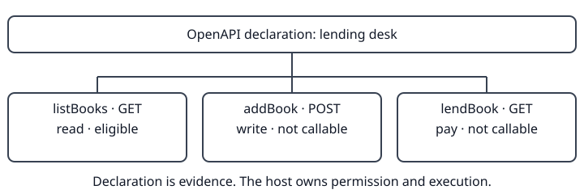

# Topos OpenAPI

Read an OpenAPI 3 document as operations, access requirements and declared effects. This world interprets supplied bytes. A separate host owns permission and execution.

## Door

Verify the standing and exact capsule by digest, register its declared views, and supply documents through the provider-input channel. A digest establishes integrity, not permission to connect.

## Idea

A document claims what an API does; it does not prove behavior. Method classifications and explicit effects remain separate. Receiving the world grants no authority and never imports credentials.

## One document, three answers

The example declares `listBooks` as a read, `addBook` as a write and `lendBook` with an explicit payment effect despite its GET method. Only the read is eligible under those declarations. Nothing in the example contacts an API.

## Learn

[Run the whole example](examples/release/one-document.ts). It prints the world's declaration, endpoints, effects, callability readings and the standing a host can adopt.

## Endpoints

Each operation becomes a named form with its method, path and declared input and answer fields. Unknown or conflicting input is refused rather than guessed.

## Effects

A read method does not override an explicit non-read effect. The host must evaluate its own authority before executing any offer.

## Auth

Security schemes declare how access is proved. The [x-access profile](docs/x-access.md) describes obtaining that proof; the world never guesses a login flow, reads a keychain or asks a server for credentials.

## Claims

Descriptions, effect hints and schemas are evidence supplied by the document. They are not proof of remote behavior, permission, or a trusted network destination.

## Install

The release unit is a capsule archive and canonical standing, selected by exact digest. The host supplies documents, overlays, budgets, consent, transport and secrets. This private producer package is not an API client installed from npm.

## Refuses

Missing provider lines, insufficient declared reads, invalid documents and conflicting interpretations refuse. Unknown or undeclared response fields remain withheld. Hosts must reject ambiguous compiler claims.

## Reading

`spec` interprets documents and overlays. `openapi-place` projects each source into regions, access metadata and offers. It uses exactly the same implementation as the retained `place` view; its separate provider selector permits independent composition with other worlds.

## How they rest

Topos supplies the wire and capsule interfaces; Bound checks the producer's obligations. Neither a suggested action nor receiving bytes installs authority. Version 0.1.2 retains Topos 0.2.0 and yaml 2.9.1.

## Check

Run `npm ci --ignore-scripts`, `npm run build`, and `node --test test/prior-place.test.ts test/compile-region.test.ts`. These verify this world's contracts. The source reader checks current input bytes with the published physical-line model. The source contains 512 physical lines; the alias adds none. A ceiling change is a separate, measured owner decision, not a result of conformance tests.

## Pointers

[Region contracts](docs/reference.md) · [Access profile](docs/x-access.md) · [Whole example](examples/release/one-document.ts)
